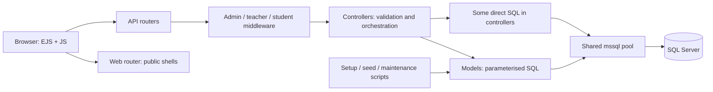

# System map

Status: **verified by static inspection**, target changes **proposed**. Review: 25 October 2026. File references are repository-relative `file:line`; line numbers refer to the captured source baseline.

## Boot and lifecycle

1. `package.json:8` defines start/development scripts with pre-hooks invoking `scripts/freePort.js`. That script uses Windows subprocess commands and force-kills listener PIDs without confirming application ownership. These commands were not run.
2. `server.js:1` attempts root environment loading, imports the app at line 3 and reads PORT at line 7. During imports, `config/database.js:3` loads `config/.env`, constructs a shared pool at line 8 and calls `pool.connect()` at line 11.
3. Routers import controllers/models, which import that database module. Importing the application is not an isolated, connection-free test operation.
4. `server.js:22` waits for the pool, calls `Admin.createTable()` at line 24, then listens. Startup therefore performs DDL; it does not initialise all academic tables.
5. `app/app.js:25` configures EJS, logging at line 28, cache headers at line 29, static files at line 37, JSON/URL body parsing at lines 38–39, page routes at line 42, APIs at lines 44–58 and errors at lines 61–64.

## Module boundaries

| Area | Source | Dependencies and limitations |
|---|---|---|
| Identity | staff/student controllers; `middlewares/is*Login.js`; `utils` | Separate account tables; ID-only token; no account-type or tenant verification |
| Academic structure | class, subject, academicYear, classSubject models | Global class/subject catalogues; inconsistent year scope |
| Student records | `model/Academic/student.js` | Mutable current class/year, guardians, medical string, fees |
| Personnel | `model/staff` | Teacher status and admin records; auxiliary records have no auth identity |
| Marks/reporting | marks/reportCard controllers, subjectScore model | Offering/year/term/sequence scores; report SQL bypasses model boundary |
| Scheduling | allocation, timetable, timeSlot models/controllers | Year-aware schedules; term-only teacher assignments |
| MCQ | exam, question, examResult | Distinct assessment domain; publication gate; missing object checks |
| Geography | location model/controller | Seeded Cameroon hierarchy; candidate read-only global catalogue |
| Browser | `views`, `public/js`, `public/css` | localStorage tokens, Fetch, generated HTML; duplicated management surfaces |
| Tooling | `scripts` | No migration ledger or safe test configuration boundary |

## API and page surface

Fifteen API mounts live under `/api/v1`: admin, teachers, students, subjects, classes, academic-years, exams, exam-results, timetables, allocations, locations, marks, class-subject-students, report-cards, auxiliary. Full method/path and handler inventory is in `ROUTE_PERMISSION_MATRIX.md`.

Web shells are public; browser guards are convenience checks. `routes/webRouter.js` maps 13 GET pages; two additional EJS files are shared header/footer partials. Main admin layout owns five top-level tabs and nested registration/evaluation panels. Timetable, allocation and promotion are separate pages. `description/description.htm` is a static design reference, not a router mount.

## Dependencies and external services

The package-declared dependency ranges are recorded below in the generated inventory. Runtime integration observed: SQL Server. No payment processor, mail/SMS provider, object storage, job queue, platform subscriptions or external identity provider was found. Installed-version security/advisory assessment is **not performed**; dependency presence is not proof of safety. No network research or dependency update was needed for this source audit.

Configuration: DB_STRING is required by pool construction; PORT defaults to 2026; admin seeding accepts ADMIN_EMAIL/ADMIN_PASSWORD. `config/.env` exists and was not read or copied. Root `.env` is not required by the documented DB loader. Secret validation, environment separation and graceful pool shutdown need explicit implementation.

## Proposed incremental architecture

Retain Express/EJS/SQL Server. Add a small service layer for transactions and permission-sensitive workflows, tenant-scoped repositories with explicit request context, and pure policy functions for grading/attendance. Controllers validate DTOs and call services; they should not perform unscoped SQL. Avoid a wholesale framework rewrite.

Proposed context: canonical account ID, verified school membership, permission set, school timezone and request/audit ID. School context must be established server-side from an active membership and cannot be accepted solely from body/query/header. A separate platform control plane uses explicit cross-school permissions and audited target-school selection; ordinary school admin routes never become platform-wide via a flag.

Use SQL composite tenant keys/FKs as defence in depth. Row-level security may be evaluated later; it is not a substitute for scoped repositories and is not assumed present. Avoid pool-wide SESSION_CONTEXT tenancy unless per-request reset, transaction binding and leakage tests have been designed.

## Operational unknowns

Actual DB version/collation/schema, deployment host, process supervision, HTTPS proxy configuration, available backups, data volume, concurrent users, browser support, pilot schools and restore objectives remain decisions or test prerequisites. Repository discovery previously failed at the parent path; no branch/remote or release baseline is claimed. No usable AGENTS.md was found by project inventory search.

## Source and dependency inventory

The following inventory is generated from file names and declarations without importing application modules.

### Runtime package declarations

| Dependency | Declared range |
|---|---|
| bcrypt | ^6.0.0 |
| bcryptjs | ^3.0.3 |
| dotenv | ^17.4.2 |
| ejs | ^6.0.1 |
| express | ^5.2.1 |
| express-async-handler | ^1.2.0 |
| jsonwebtoken | ^9.0.3 |
| morgan | ^1.11.0 |
| mssql | ^12.5.5 |
| nodemon | ^3.1.14 |

### First-party application source inventory

| File | Functions/exports or purpose |
|---|---|
| app/app.js | Configuration/entrypoint/helpers |
| config/database.js | Configuration/entrypoint/helpers |
| controllers/academic/academicYearCtrl.js | createAcademicYearCtrl, getAllAcademicYearsCtrl, singleAcademicYearCtrl, setCurrentAcademicYearCtrl, deleteAcademicYearCtrl |
| controllers/academic/classCtrl.js | getAllClassesCtrl, singleClassCtrl, classSubjectsCtrl, updateClassCtrl, getClassesWithFeesCtrl |
| controllers/academic/classSubjectStudentCtrl.js | getClassSubjectStudentsCtrl, enrollStudentCtrl, unenrollStudentCtrl, bulkEnrollCtrl, bulkUnenrollCtrl |
| controllers/academic/examCtrl.js | createExamCtrl, getAllExamsCtrl, singleExamCtrl, updateExamStatusCtrl, addQuestionCtrl, getExamQuestionsCtrl, studentExamQuestionsCtrl, takeExamCtrl |
| controllers/academic/examResultCtrl.js | getMyResultsCtrl, getExamResultsCtrl |
| controllers/academic/locationCtrl.js | getRegionsCtrl, getDivisionsCtrl, getSubdivisionsCtrl |
| controllers/academic/marksCtrl.js | getStudentsWithScoresCtrl, saveScoresCtrl, saveAllScoresCtrl |
| controllers/academic/promotionCtrl.js | promoteClassCtrl, getStudentsByClassCtrl |
| controllers/academic/reportCardCtrl.js | gradeFromScore, getReportCardCtrl |
| controllers/academic/subjectAllocationCtrl.js | setAllocationCtrl, getClassAllocationsCtrl, getAllAllocationsCtrl, deleteAllocationCtrl, getFormDataCtrl |
| controllers/academic/subjectCtrl.js | createSubjectCtrl, getAllSubjectsCtrl, singleSubjectCtrl, updateSubjectCtrl, deleteSubjectCtrl |
| controllers/academic/timetableCtrl.js | createEntryCtrl, getClassGridCtrl, getClassTimetableCtrl, getTeacherTimetableCtrl, getStudentTimetableCtrl, getAllEntriesCtrl, generateClassCtrl, deleteEntryCtrl, getFormDataCtrl, getClassPeriodsCtrl |
| controllers/staff/adminCtrl.js | registeradminCtrl, loginadminCtrl, alladminCtrl, getadminprofile, singleadminCtrl, updateadminCtrl, deleteadminCtrl, setTeacherStatusCtrl, publishexamCtrl, unpublishexamCtrl, getAdminStatsCtrl |
| controllers/staff/auxiliaryCtrl.js | registerAuxiliaryCtrl, getAllAuxiliaryCtrl, singleAuxiliaryCtrl, updateAuxiliaryCtrl, deleteAuxiliaryCtrl, setStatusAuxiliaryCtrl |
| controllers/staff/teacherCtrl.js | registerTeacherCtrl, loginTeacherCtrl, getAllTeachersCtrl, getTeacherProfileCtrl, updateTeacherProfileCtrl, getMySubjectsCtrl, getMyStudentsCtrl, assignTeacherCtrl, singleTeacherCtrl, adminUpdateTeacherCtrl, deleteTeacherCtrl |
| controllers/students/studentCtrl.js | registerStudentCtrl, loginStudentCtrl, getAllStudentsCtrl, getStudentProfileCtrl, updateStudentProfileCtrl, singleStudentCtrl, adminUpdateStudentCtrl, deleteStudentCtrl |
| description/description.htm | Design reference |
| middlewares/globalErrHandler.js | Configuration/entrypoint/helpers |
| middlewares/isLogin.js | Configuration/entrypoint/helpers |
| middlewares/isStudentLogin.js | Configuration/entrypoint/helpers |
| middlewares/isTeacherLogin.js | Configuration/entrypoint/helpers |
| model/Academic/academicYear.js | createTable, createEnrollmentTables, create, setCurrent, enrollStudent, assignTeacher, getAll, findById, findCurrent |
| model/Academic/class.js | createTable, seedDefaults, migrate, getAll, findById, updateClass |
| model/Academic/classSubject.js | createTable, offerInAllClasses, offer, getTeacherMap, findOffering, findOfferingById, assignTeacher, getTeacherTeaching, getClassSubjects |
| model/Academic/classSubjectStudent.js | createTable, enroll, unenroll, bulkEnroll, bulkUnenroll, getEnrolled, getUnenrolled, isEnrolled, getByClassSubject |
| model/Academic/exam.js | createTable, create, setStatus, getAll, findById |
| model/Academic/examResult.js | createTable, create, publishByExam, unpublishByExam, findForStudentExam, getPublishedForStudent, getByExam, findById |
| model/Academic/location.js | createTable, seed, getRegions, getDivisions, getSubdivisions |
| model/Academic/question.js | createTable, create, getByExam, getByExamForStudent, findById |
| model/Academic/student.js | normalizePhone, createTable, createFeesTable, migrate, create, getAll, getAllFull, findById, getForTeacher, findByMatricule, update, setWithdrawn, setPromoted, getByClass, saveFees, getFees, promoteClass, remove |
| model/Academic/subject.js | createTable, migrate, create, getAll, findById, findByCode, update, remove |
| model/Academic/subjectAllocation.js | createTable, set, getByClass, getAll, delete |
| model/Academic/subjectScore.js | createTable, migrate, getScores, upsertScore, getClassStudentsWithScores |
| model/Academic/timeSlot.js | createTable, seed, getAll, getTeaching |
| model/Academic/timetable.js | createTable, migrate, create, getGridByClass, getByClass, getByTeacher, getByStudent, getAll, getPeriodsPerSubject, delete, deleteForClass, getTeacherBusy |
| model/staff/admin.js | createTable, findByEmail, findById, create, getAll, update, remove |
| model/staff/auxiliary.js | buildFullName, createTable, create, getAll, findById, findByEmail, update, setStatus, remove |
| model/staff/teacher.js | buildFullName, createTable, migrate, create, getAll, findById, findByEmail, update, setStatus, remove |
| package.json | Configuration/entrypoint/helpers |
| public/css/style.css | Shared styles |
| public/js/admin-layout.js | switchTab, doLogout, loadProfile, loadStats, loadStudentClasses, loadAcademicYearOptions, updateStudentFeesTotal, resetStudentForm, loadStudentTable, renderStudentTable, highlightStudentRow, fillStudentForm, function, loadTeacherTable, renderTeacherTable, highlightTeacherRow, resetTeacherForm, fillTeacherForm, loadSubjectTable, renderSubjectTable, resetSubjectForm, loadTeachers, loadSubjectMasters, loadSubjectClasses, loadClassesForReg, renderClassTable, selectClass, highlightTableRow, populateClassNameDropdown, updateClassFeesTotal, loadAuxiliaryTable, renderAuxiliaryTable, resetAuxiliaryForm, loadAcademicYears, renderAcademicYears, highlightAYRow, fillAYForm, loadPersonnel, activateFromStorage, gradeFromScore, loadEvalDropdowns, loadEvalSubjectsByClass, renderMarksTable, loadCourseReview, findClassSubjectId, renderCrLists, renderReportCard |
| public/js/allocations.js | loadFormData, loadAllocations |
| public/js/app.js | api, logout, esc, renderProfileCard |
| public/js/auth.js | updateIdentLabel |
| public/js/location-picker.js | loadRegions, loadDivisions |
| public/js/nav.js | Configuration/entrypoint/helpers |
| public/js/promotion.js | Configuration/entrypoint/helpers |
| public/js/student-dashboard.js | loadProfile |
| public/js/students.js | loadClasses, renderStudents, loadStudents, editStudent, clearForm |
| public/js/subjects.js | loadSubjects |
| public/js/teacher-dashboard.js | teacherName, loadProfile, loadMySubjects, loadMyStudents, fullStudentName, loadMarksSubjects |
| public/js/teachers.js | fullName, statusBadge, loadTeachers, loadAssignDropdowns |
| public/js/timetable.js | buildGridHtml, groupBySlotAndDay, loadGrid |
| routes/academic/academicYearRouter.js | Configuration/entrypoint/helpers |
| routes/academic/classRouter.js | Configuration/entrypoint/helpers |
| routes/academic/classSubjectStudentRouter.js | Configuration/entrypoint/helpers |
| routes/academic/examResultRouter.js | Configuration/entrypoint/helpers |
| routes/academic/examRouter.js | Configuration/entrypoint/helpers |
| routes/academic/locationRouter.js | Configuration/entrypoint/helpers |
| routes/academic/marksRouter.js | Configuration/entrypoint/helpers |
| routes/academic/reportCardRouter.js | Configuration/entrypoint/helpers |
| routes/academic/subjectAllocationRouter.js | Configuration/entrypoint/helpers |
| routes/academic/subjectRouter.js | Configuration/entrypoint/helpers |
| routes/academic/timetableRouter.js | Configuration/entrypoint/helpers |
| routes/staff/adminRouter.js | Configuration/entrypoint/helpers |
| routes/staff/auxiliaryRouter.js | Configuration/entrypoint/helpers |
| routes/staff/teacherRouter.js | Configuration/entrypoint/helpers |
| routes/students/studentRouter.js | Configuration/entrypoint/helpers |
| routes/webRouter.js | Configuration/entrypoint/helpers |
| scripts/freePort.js | killOnPort |
| scripts/migrateStudents.js | main |
| scripts/resetPasswords.js | Configuration/entrypoint/helpers |
| scripts/seedAdmin.js | main |
| scripts/seedDemo.js | ensureSubjects, ensureTeachers, main, generateClass |
| scripts/seedStudents.js | pick, randomDate, run |
| scripts/setupAcademic.js | main |
| server.js | Configuration/entrypoint/helpers |
| utils/generateToken.js | Configuration/entrypoint/helpers |
| utils/verifyToken.js | Configuration/entrypoint/helpers |
| views/admin-layout.ejs | EJS page/partial |
| views/allocations.ejs | EJS page/partial |
| views/landing.ejs | EJS page/partial |
| views/login.ejs | EJS page/partial |
| views/partials/footer.ejs | EJS page/partial |
| views/partials/header.ejs | EJS page/partial |
| views/promotion.ejs | EJS page/partial |
| views/student-dashboard.ejs | EJS page/partial |
| views/students.ejs | EJS page/partial |
| views/subjects.ejs | EJS page/partial |
| views/teacher-dashboard.ejs | EJS page/partial |
| views/teachers.ejs | EJS page/partial |
| views/timetable-student.ejs | EJS page/partial |
| views/timetable-teacher.ejs | EJS page/partial |
| views/timetable.ejs | EJS page/partial |
